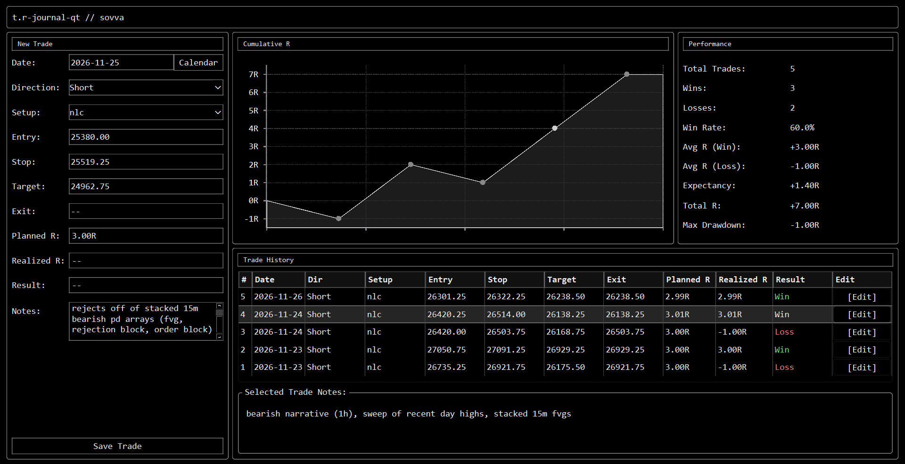

# tr-journal-qt

A minimalist desktop trading journal and performance analytics application built with Python and PySide6.

Designed to track trade execution, evaluate risk-to-reward performance, and visualize trading consistency through a terminal-inspired interface.

## Preview



## Features

- Trade logging, editing, and deletion
- Automatic planned and realized R calculations
- Interactive cumulative R chart
- Win rate, expectancy, and drawdown analytics
- Trade history and individual trade notes
- Persistent local JSON storage

## Built With

- Python
- PySide6 / Qt6
- Qt Charts
- JSON

## Installation

```bash
git clone https://github.com/sovva-ob/tr-journal-qt.git
cd tr-journal-qt
pip install -r requirements.txt
python main.py
```

## Data Storage

All trade data is stored locally. No external services or accounts are required.